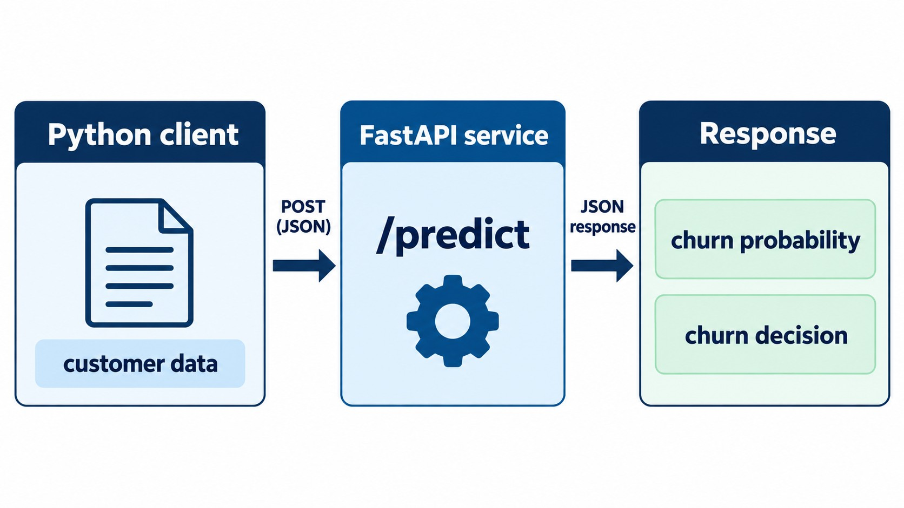
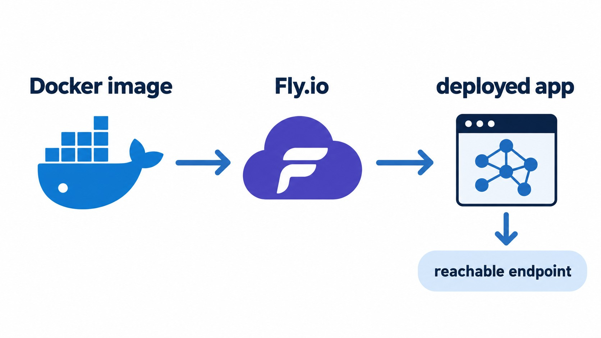

# Lesson 05 Workshop - Deploying ML Models with FastAPI and uv

This folder holds my work for the [Module 5 workshop](https://github.com/DataTalksClub/machine-learning-zoomcamp/tree/main/05-deployment/workshop) of [ML Zoomcamp](https://github.com/DataTalksClub/machine-learning-zoomcamp) ([video](https://www.youtube.com/watch?v=jzGzw98Eikk)).

The workshop takes the churn model from [lesson-05](../lesson-05/) and redoes the deployment with newer tools:

| Lesson 05 | Workshop |
|-----------|----------|
| `(dv, model)` tuple | Scikit-Learn pipeline (one object) |
| Pipenv | uv |
| Flask | FastAPI |
| No input validation | Pydantic |
| AWS Elastic Beanstalk | Fly.io |

## Progress

| # | Step | Status | Where |
|---|------|--------|-------|
| 1 | Save and load the model with `pickle` | Done | [05-deployment-workshop.ipynb](05-deployment-workshop.ipynb) |
| 2 | Combine `DictVectorizer` + `LogisticRegression` with `make_pipeline` | Done | notebook, [train.py](train.py) |
| 3 | Turn the notebook into a training script | Done | [train.py](train.py) |
| 4 | First FastAPI app (`/ping`) | Done | [ping.py](ping.py) |
| 5 | Serve the model on `/predict` | Done | [predict.py](predict.py) |
| 6 | Validate input and output with Pydantic | Done | [predict.py](predict.py) (`Customer`, `PredictResponse`) |
| 6b | Reject extra fields with `ConfigDict(extra="forbid")` | Pending | - |
| 7 | Manage the environment with uv | Done | [pyproject.toml](pyproject.toml), [uv.lock](uv.lock) |
| 8 | Containerize with Docker | Done | [Dockerfile](Dockerfile) |
| 9 | Deploy to Fly.io | In progress | [fly.toml](fly.toml) |

The client that calls the API lives in the notebook. Upstream it's a separate `test.py`, which isn't in this folder.

## Project structure

| File | Purpose |
|------|---------|
| [05-deployment-workshop.ipynb](05-deployment-workshop.ipynb) | Starter notebook: training, pickle, pipeline and the `requests` client |
| [train.py](train.py) | Downloads the Telco churn dataset, trains the pipeline and saves it to `model.bin` |
| `model.bin` | Pickled sklearn `Pipeline` (a single object, not a `(dv, model)` tuple) |
| [ping.py](ping.py) | Minimal FastAPI app: `GET /ping` returns `PONG` |
| [predict.py](predict.py) | FastAPI service: `POST /predict` with Pydantic validation |
| [Dockerfile](Dockerfile) | Image based on `python:3.13.5-slim-bookworm` with uv |
| [fly.toml](fly.toml) | Fly.io app configuration (internal port `9696`) |
| [pyproject.toml](pyproject.toml) / [uv.lock](uv.lock) / `.python-version` | uv project, Python `3.13` |
| [images/](images/) | Diagrams from the upstream workshop |

## How to use it

Install the dependencies from the `lesson-05-workshop/` folder:

```bash
uv sync
```

### 1. Train the model (optional)

`model.bin` is already in the folder. To regenerate it:

```bash
uv run python train.py
```

### 2. Run the service

```bash
uv run uvicorn predict:app --host 0.0.0.0 --port 9696 --reload
```

FastAPI generates interactive docs at http://localhost:9696/docs, which Flask doesn't do.

Send a customer with `curl`:

```bash
curl -X POST http://localhost:9696/predict \
  -H 'Content-Type: application/json' \
  -d '{"gender": "female", "seniorcitizen": 0, "partner": "yes", "dependents": "no",
       "phoneservice": "no", "multiplelines": "no_phone_service", "internetservice": "dsl",
       "onlinesecurity": "no", "onlinebackup": "yes", "deviceprotection": "no",
       "techsupport": "no", "streamingtv": "no", "streamingmovies": "no",
       "contract": "month-to-month", "paperlessbilling": "yes",
       "paymentmethod": "electronic_check", "tenure": 1,
       "monthlycharges": 29.85, "totalcharges": 29.85}'
```

The response has `churn_probability` and `churn`:

<p align="center">
  
</p>

Pydantic rejects invalid values with an error. For example, `"streamingtv": "maybe"` returns a `literal_error`.

### 3. Run with Docker

```bash
docker build -t predict-churn .
docker run -it --rm -p 9696:9696 predict-churn
```

### 4. Deploy to Fly.io

```bash
curl -L https://fly.io/install.sh | sh   # install flyctl
fly auth signup
fly launch --generate-name
fly deploy
```

Put the URL from the logs into the client and check that it works. Destroy the app when you're done, because Fly.io can charge for it:

```bash
fly apps list
fly apps destroy <app-name>
```

<p align="center">
  
</p>

## References

- Workshop: [05-deployment/workshop](https://github.com/DataTalksClub/machine-learning-zoomcamp/tree/main/05-deployment/workshop)
- Module 5 notes: [05-deployment](https://github.com/DataTalksClub/machine-learning-zoomcamp/tree/main/05-deployment)
- [FastAPI](https://fastapi.tiangolo.com/), [Pydantic](https://docs.pydantic.dev/), [uv](https://docs.astral.sh/uv/), [Fly.io](https://fly.io/docs/)
