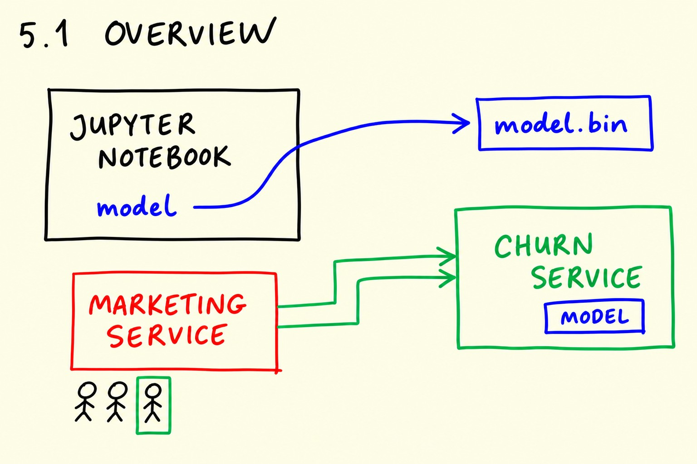
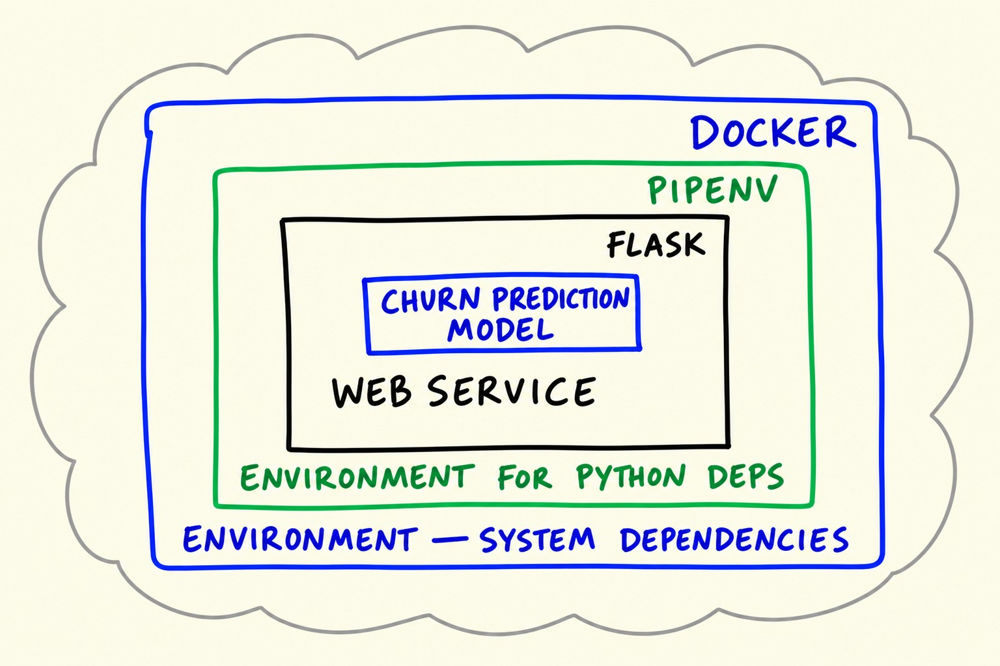
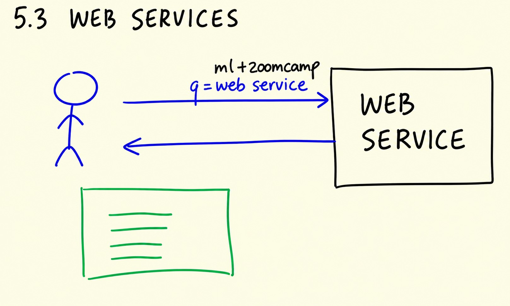
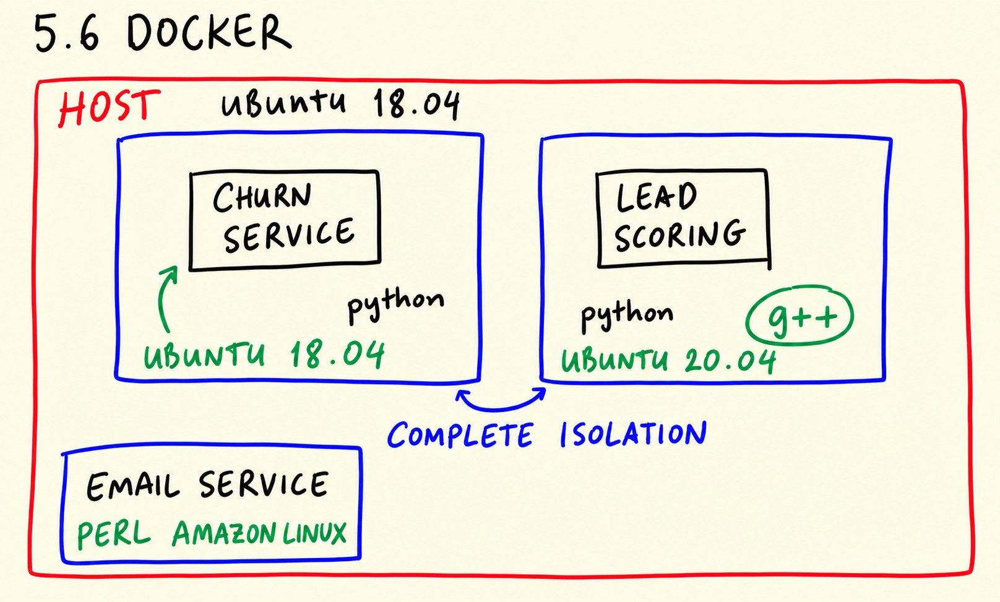
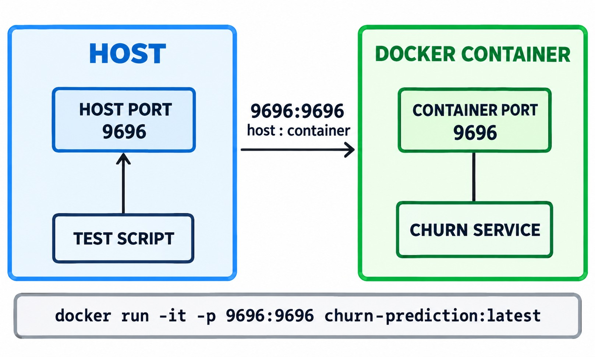
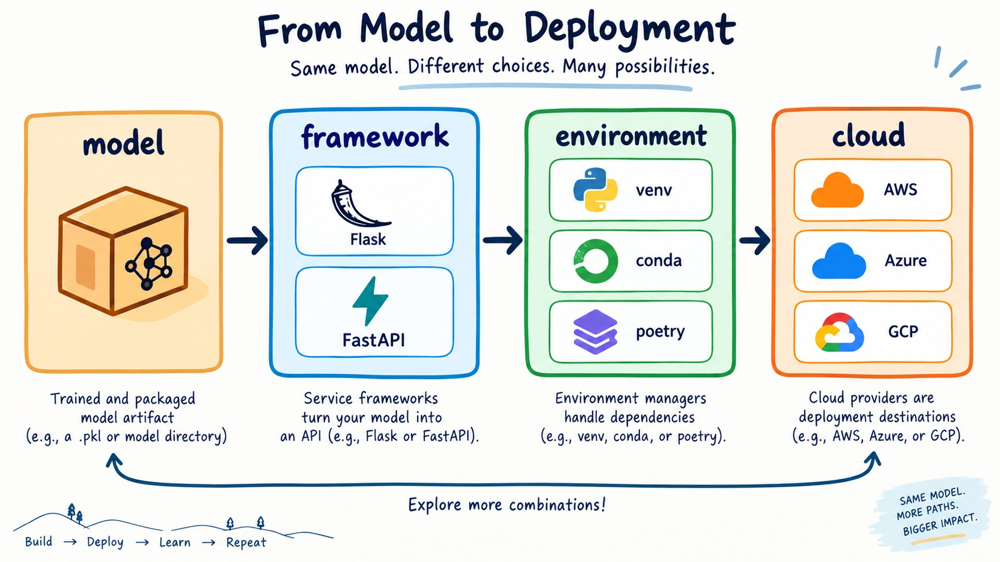

# 5.1 Intro / Session overview

In this unit we look at what we will build in module 5: taking the churn
prediction model we trained earlier and turning it into a service that other
systems can call over the network.

## The problem: the model lives in a notebook

In module 3 we trained a model that predicts whether a customer of a telecom
company will churn - stop using the service. The model is useful only if
people can actually use it. Right now it lives inside a notebook: to get a
prediction, we open the notebook, run all the cells, and look at the output.
That is fine for us, but the rest of the company cannot work this way.

Imagine the marketing team wants to send a promo email to customers who are
likely to leave. Their system needs to ask the model: "what is the churn
probability of this customer?" - automatically, for thousands of customers,
without anyone opening a notebook.

The solution is to deploy the model: run it on a server and expose an API
endpoint. Other services - like the marketing service - send a request with
the customer information to this endpoint, and get the prediction back in the
response. Based on that response, the marketing service can decide to send a
promo email or do nothing.

<p align="center">
  
</p>

## The plan for this module

We will take the churn model from the notebook to a working web service step
by step:

- Saving and loading the model with pickle, and turning the notebook into a
  Python script, so the model can be used without re-training it every time.
- Creating a web service with Flask: first a small ping/pong service, then
  the actual churn service that answers prediction requests.
- Preparing the service for production with gunicorn (or waitress on
  Windows) instead of the Flask development server.
- Managing the project dependencies with Pipenv, so the service runs with the
  library versions we tested it with.
- Packaging everything into a Docker container, so it can run the same way on
  any machine.
- Finally, deploying the container to the cloud with AWS Elastic Beanstalk
  (optional), which makes the service available on the internet.

Each step removes one thing that ties the model to our laptop: the notebook,
the development server, the system-wide Python packages, the operating system
and finally the local machine itself.

<p align="center">
  
</p>

## Notes


In this session, we talked about the earlier model we made in chapter 3 for churn prediction. <br>
This chapter contains the deployment of the model. If we want to use the model to predict new values without running the code, there's a way to do this. The way to use the model in different machines without running the code, is to deploy the model in a server (run the code and make the model). After deploying the code in a machine used as server we can make some endpoints (using api's) to connect from another machine to the server and predict values.

Model deployment is crucial when you need to use the model across different machines or applications without having to retrain or rerun the code. By deploying the model as a web service, external systems (like marketing services) can send requests to the server to get predictions, such as whether a customer is likely to churn. Based on the prediction, actions like sending promotional offers can be automated.

To deploy the model in a server there are some steps:
1. **Train and Save the Model**: After training the model, save it as a file, to use it for making predictions in future (session 02-pickle).
2. **Create API Endpoints**: Make the API endpoints in order to request predictions. It is possible to use the Flask framework to create web service API endpoints that other services can interact with (session 03-flask-intro and 04-flask-deployment).
3. **Some other server deployment options** (sessions 5 to 9):
   - **Pipenv**: Create isolated environments to manage the Python dependencies of the web service, ensuring they don't interfere with other services on the machine.
   - **Docker**: Package the service in a Docker container, which includes both system and Python dependencies, making it easier to deploy consistently across different environments. 
4. **Deploy to the Cloud**: Finally, deploy the Docker container to a cloud service like AWS to make the model accessible globally, ensuring scalability and reliability.

# 5.2 Pickle | Saving and loading the model

In this unit we save the trained churn model to a file with pickle, load it
back, and turn the notebook into a Python script - so the model can be used
later without training it again.

## Why we need to save the model

Training gives us two objects: the `DictVectorizer` that turns customer
records into a feature matrix, and the logistic regression model itself. Both
live in the memory of the notebook process - close the notebook and they are
gone.

Re-training the model every time we want a prediction is wasteful: training
takes time, and we would get a slightly different model depending on the data
split and random state. What we want instead is to train once, save the
result to a file, and later simply load that file in the web service.

## Saving with pickle

Pickle is a standard Python library for serializing objects: it writes a
Python object into a binary file, and can read it back later. We save both
the vectorizer and the model together as a tuple:

```python
import pickle

output_file = f'model_C={C}.bin'

with open(output_file, 'wb') as f_out:
    pickle.dump((dv, model), f_out)
```

The `'wb'` mode means write-binary - pickle produces binary data, so we must
not open the file in text mode. We name the file with the value of `C` we
used, because after tuning in the previous module we know this parameter, and
it is useful to see it in the filename: `model_C=1.0.bin`.

The vectorizer has to travel with the model. It was fitted on the training
data and it "remembers" which categorical values map to which feature columns
- without it, we cannot prepare a new customer record the same way.

## Loading the model

To use the model - for example, from a web service - we load the file back:

```python
import pickle

with open('model_C=1.0.bin', 'rb') as f_in:
    dv, model = pickle.load(f_in)
```

Here `'rb'` is read-binary. `pickle.load` returns the tuple we saved, and we
unpack it into `dv` and `model`. From this point we can score customers
without running any training code.

One warning: never unpickle a file from a source you do not trust. Pickle
files can contain code, and loading one executes it - only load files you
created yourself or that come from someone you trust.

## From notebook to script

The last step is moving the training code out of the notebook into a plain
Python script. The script - [train.py](code/train.py) in the module's
[code/](code/) directory - contains the same steps we developed in the
notebook:

- loading and cleaning the churn dataset,
- splitting it into train and test,
- the `train` and `predict` functions,
- cross-validation with `KFold` to report the AUC for `C=1.0`,
- training the final model and saving it with pickle.

A script is what we will actually run on a server: it is reproducible, it can
be executed by a scheduler or a CI job, and it does not require a running
Jupyter instance.

In the [next unit](03-flask-intro.md) we create our first web service with
Flask.

## Notes
**In this session we'll cover the idea "How to use the model in future without training and evaluating the code"**
- To save the model we made before there is an option using the pickle library:
  - First install the library with the command ```pip install pickle-mixin``` if you don't have it.
  - After training the model and making it ready for the prediction process, use this code to save the model for later.
  - ```python
    import pickle
    
    with open('model.bin', 'wb') as f_out: # 'wb' means write-binary
        pickle.dump((dict_vectorizer, model), f_out)
    ```
  - In the code above we'll make a binary file named model.bin, and write the dict_vectorizer for one hot encoding and the model as array in it. (We will save it as binary in case it wouldn't be readable by humans)
  - To be able to use the model in future without running the code, We need to open the binary file we saved before.
  - ```python
    import pickle
    
    with open('mode.bin', 'rb') as f_in: # very important to use 'rb' here, it means read-binary 
        dict_vectorizer, model = pickle.load(f_in)
    ## Note: never open a binary file you do not trust the source!
    ```
   - With unpacking the model and the dict_vectorizer, We're able to predict again for new input values without training a new model by re-running the code.

# 5.3 Flask-intro
## Web services: introduction to Flask

In this unit we learn what a web service is and write our first one: a tiny
Flask app that answers a ping request with "PONG".

## What is a web service?

A web service is a way for applications to talk to each other over HTTP - the
same protocol your browser uses to load websites. One application (a client)
sends a request to an address (a URL), and the other application (the server)
sends back a response.

<p align="center">
  
</p>

The client says not only where to send the request, but also what it wants to
do - this is the HTTP method. The most common ones:

- GET - retrieve something. Opening a page in the browser sends a GET
  request; searching for a cat picture on Google is a GET request too.
- POST - send data to the server, for example the signup form with your name
  and email, or a customer record we want to score.
- PUT - similar to POST, but the request says where the data should go.
- DELETE - remove something from the server.

For our model deployment we care about two of them: GET for a health-check
endpoint, and POST for sending customer data to the model.

## A ping/pong service in Flask

Flask is a Python framework for building web services. Install it with
`pip install flask`. Our first service is the smallest useful example - the
[ping.py](code/ping.py) script:

```python
from flask import Flask

app = Flask('ping')

@app.route('/ping', methods=['GET'])
def ping():
    return "PONG"

if __name__ == "__main__":
    app.run(debug=True, host='0.0.0.0', port=9696)
```

Line by line:

- `app = Flask('ping')` creates the application and gives it a name.
- `@app.route('/ping', methods=['GET'])` is a decorator: it tells Flask that
  the function below should handle GET requests to the `/ping` address. This
  address is called a route.
- `ping()` returns the response body - the string `PONG`.
- The `if __name__ == "__main__"` block runs the development server, but only
  when we execute the file directly (`python ping.py`), not when we import it
  from another file. `host='0.0.0.0'` makes the server listen on all network
  interfaces - not only localhost - and `port=9696` sets the port.

A note on addresses: `localhost` (also `127.0.0.1`) is the machine itself.
Binding to `0.0.0.0` instead means "accept requests coming from the network",
which is what we want once the service runs on a server. For local
development either works.

## Testing it

Run the service:

```bash
python ping.py
```

Then, from another terminal, query it with curl - a command-line tool for
making HTTP requests:

```bash
curl http://localhost:9696/ping
```

The response is:

```
PONG
```

Opening `http://localhost:9696/ping` in a browser works as well - the browser
also sends a GET request. With that, we have a running web service. In the
[next unit](04-flask-deployment.md) we replace `PONG` with actual churn
predictions.

## Materials

- [Slides](https://www.slideshare.net/AlexeyGrigorev/ml-zoomcamp-5-model-deployment)
- [0.0.0.0 vs localhost](https://stackoverflow.com/a/20778887/861423)
- [Top-level script environment (`__main__`)](https://docs.python.org/3.9/library/__main__.html)
- [Route decorator](https://flask.palletsprojects.com/en/2.2.x/api/#flask.Flask.route)

## Notes
In this session we talked about what is a web service and how to create a simple web service.
- What is actually a web service
  - A web service is a method used to communicate between electronic devices.
  - There are some methods in web services that we can use to satisfy our problems. Here below we would list some.
    - **GET:**  GET is a method used to retrieve files, For example when we are searching for a cat image in google we are actually requesting cat images with GET method.
    - **POST:** POST is the second common method used in web services. It enables sending data to a server to create or update a resource. For example in a sign up process, when we are submiting our name, username, passwords, etc we are posting our data to a server that is using the web service. (Note that there is no specification where the data goes)
    - **PUT:** PUT is same as POST but we are specifying where the data is going to.
    - **DELETE:** DELETE is a method that is used to request to delete some data from the server.
    -  For more information just google the HTTP methods, You'll find useful information about this.
- To create a simple web service, there are plenty libraries available in every language. Here we would like to introduce Flask library in python.
  - If you haven't installed the library just try installing it with the code ```pip install Flask```
  - To create a simple web service just run the code below:
  - ```python
    from flask import Flask
    
    app = Flask('ping') # give an identity to your web service
    
    @app.route('/ping', methods=['GET']) # use decorator to add Flask's functionality to our function
    def ping():
        return 'PONG'
    
    if __name__ == '__main__':
       app.run(debug=True, host='0.0.0.0', port=9696) # run the code in local machine with the debugging mode true and port 9696
    ```
   - With the code above we made a simple web server and created a route named ping that would send pong string.
   - To test it, just use the `cURL` command in a new terminal by typing ```curl http://localhost:9696/ping```, or simply open your browser and search ```localhost:9696/ping```, You'll see that the 'PONG' string is received. Congrats You've made a simple web server 🥳.
- To use our web server to predict new values we must modify it. See how in the next session.

# 5.4 Flask-deployment
## Serving the churn model with Flask

In this unit we wrap the churn model into a Flask web service: it loads the
pickled model, listens for POST requests with customer data, and replies with
the churn probability.

## The web service

We take the ping app from the [previous unit](03-flask-intro.md) and extend
it. The full service is in [predict.py](code/predict.py):

```python
import pickle

from flask import Flask
from flask import request
from flask import jsonify


model_file = 'model_C=1.0.bin'

with open(model_file, 'rb') as f_in:
    dv, model = pickle.load(f_in)

app = Flask('churn')

@app.route('/predict', methods=['POST'])
def predict():
    customer = request.get_json()

    X = dv.transform([customer])
    y_pred = model.predict_proba(X)[0, 1]
    churn = y_pred >= 0.5

    result = {
        'churn_probability': float(y_pred),
        'churn': bool(churn)
    }

    return jsonify(result)


if __name__ == "__main__":
    app.run(debug=True, host='0.0.0.0', port=9696)
```

The parts worth noting:

- The model is loaded once, at start-up - not on every request. Loading is
  fast compared to training, but there is no reason to repeat it.
- The route uses the POST method: the customer data comes in the body of the
  request as JSON, and `request.get_json()` turns it into a Python
  dictionary.
- We transform the customer with the vectorizer - a list with one dictionary,
  because the transformer expects a list of records - and take the churn
  probability from the second column of `predict_proba` (index 1 is the
  probability of the positive class, "churn").
- We apply a threshold of 0.5 to get a yes/no answer, and cast NumPy values
  to native Python `float` and `bool`. JSON has no NumPy types, and Flask
  cannot serialize them.
- `jsonify(result)` turns the dictionary into a JSON response.

## Testing the service

Run the service with `python predict.py`. A browser can't test it - browsers
send GET requests, and this route expects POST. We use a small client script,
[predict-test.py](code/predict-test.py), which sends a request with the
`requests` library:

```python
import requests

url = 'http://localhost:9696/predict'

customer = {
    "gender": "female",
    "seniorcitizen": 0,
    ...
}

response = requests.post(url, json=customer).json()
print(response)

if response['churn'] == True:
    print('sending promo email to %s' % customer_id)
else:
    print('not sending promo email to %s' % customer_id)
```

The customer dictionary holds the same fields the model saw during training.
The `json=customer` argument serializes the dictionary to JSON in the request
body. Running the script prints:

```
{'churn': False, 'churn_probability': 0.3257561103397851}
not sending promo email to xyz-123
```

This is exactly how a marketing service would talk to our model: send
customer data as JSON, get the churn decision back, act on it.

## Running in production: gunicorn

When you start the app with `python predict.py`, Flask warns that its
development server is not suitable for production - it is single-threaded and
not built for heavy load. A WSGI server is the production replacement. WSGI
(Web Server Gateway Interface) is the standard way Python web applications
are served: the WSGI server imports our `app` object and handles all the
network work around it.

The common choice is gunicorn:

```bash
pip install gunicorn
gunicorn --bind=0.0.0.0:9696 predict:app
```

The last argument is `module:app_object` - our file is `predict.py` and the
Flask application inside it is called `app`. The service behaves the same,
but now it is a real production server.

On Windows, gunicorn does not work - it depends on libraries not available
there. The Windows alternative is waitress:

```bash
pip install waitress
waitress-serve --listen=0.0.0.0:9696 predict:app
```

The [next unit](05-pipenv.md) deals with the remaining piece: keeping the
project's library versions under control.

## Materials

- [Slides](https://www.slideshare.net/AlexeyGrigorev/ml-zoomcamp-5-model-deployment)
- The full serving script this unit walks through is also available in the
  [mlbookcamp-code repository](https://github.com/alexeygrigorev/mlbookcamp-code/blob/master/chapter-05-deployment/churn_serving.py)

## Notes
In this session, we talked about implementing the functionality of prediction to our churn web service and how to make it usable in development environment.
- To make the web service predict the churn value for each customer we must modify the code in session 3 with the code we had in previous chapters. Below we can see how the code works in order to predict the churn value.
- In order to predict we need to first load the previous saved model and use a prediction function in a special route.
  - To load the previous saved model we use the code below:
  - ```python
    import pickle
    
    with open('churn-model.bin', 'rb') as f_in:
      dv, model = pickle.load(f_in)
    ```
  - As we had earlier to predict a value for a customer we need a function like below:
  - ```python
    def predict_single(customer, dv, model):
      X = dv.transform([customer])  ## apply the one-hot encoding feature to the customer data 
      y_pred = model.predict_proba(X)[:, 1]
      return y_pred[0]
    ```
   - Then at last we make the final function used for creating the web service.
   - ```python
     @app.route('/predict', methods=['POST'])  ## in order to send the customer information we need to post its data.
     def predict():
     customer = request.get_json()  ## web services work best with json frame, So after the user post its data in json format we need to access the body of json.

     prediction = predict_single(customer, dv, model)
     churn = prediction >= 0.5
     
     result = {
         'churn_probability': float(prediction), ## we need to cast numpy float type to python native float type
         'churn': bool(churn),  ## same as the line above, casting the value using bool method
     }

     return jsonify(result)  ## send back the data in json format to the user
     ```
   - The whole code above is available in this link: [churn_serving.py](https://github.com/alexeygrigorev/mlbookcamp-code/blob/master/chapter-05-deployment/churn_serving.py)
   - Finally, run your code. To see the result we can't use a simple request in web browser, because we are expecting a `POST` request in our app. We can run the code below to **post** customer data as `json` and see the response
   - ```python     
     ## a new customer informations
     customer = {
       'customerid': '8879-zkjof',
       'gender': 'female',
       'seniorcitizen': 0,
       'partner': 'no',
       'dependents': 'no',
       'tenure': 41,
       'phoneservice': 'yes',
       'multiplelines': 'no',
       'internetservice': 'dsl',
       'onlinesecurity': 'yes',
       'onlinebackup': 'no',
       'deviceprotection': 'yes',
       'techsupport': 'yes',
       'streamingtv': 'yes',
       'streamingmovies': 'yes',
       'contract': 'one_year',
       'paperlessbilling': 'yes',
       'paymentmethod': 'bank_transfer_(automatic)',
       'monthlycharges': 79.85,
       'totalcharges': 3320.75
     }
     import requests ## to use the POST method we use a library named requests
     url = 'http://localhost:9696/predict' ## this is the route we made for prediction
     response = requests.post(url, json=customer) ## post the customer information in json format
     result = response.json() ## get the server response
     print(result)
     ```
 - Until here we saw how we made a simple web server that predicts the churn value for every user. When you run your app you will see a warning that it is not a WGSI server and not suitable for production environmnets. To fix this issue and run this as a production server there are plenty of ways available. 
   - One way to create a WSGI server is to use gunicorn. To install it use the command ```pip install gunicorn```, And to run the WGSI server you can simply run it with the   command ```gunicorn --bind 0.0.0.0:9696 churn:app```. Note that in __churn:app__ the name churn is the name we set for the file containing the code ```app = Flask('churn')```(for example: churn.py), You may need to change it to whatever you named your Flask app file.  
   -  Windows users may not be able to use gunicorn library because windows system do not support some dependecies of the library. So to be able to run this on a windows machine, there is an alternative library waitress and to install it, just use the command ```pip install waitress```. 
   -  to run the waitress wgsi server use the command ```waitress-serve --listen=0.0.0.0:9696 churn:app```.
   -  To test it, you can run the code above and the result will be the same.
 - So until here you were able to make a production server that predicts the churn value for new customers. In the next session, we can see how to solve library version conflicts in each machine and manage dependencies for production environments.

# 5.5 Docker

## Environment management: Docker

In this unit we package the churn service into a Docker container, so it runs
the same way everywhere - with the same Python version and the same
dependencies, independent of the host machine.

## Installing Docker

Docker runs on Linux, Windows and macOS. To install it:

### Ubuntu

```bash
sudo apt-get install docker.io
```

To run docker without `sudo`, follow [this instruction](https://docs.docker.com/engine/install/linux-postinstall/).

### Windows

Follow the instruction by Andrew Lock: https://andrewlock.net/installing-docker-desktop-for-windows/.

If you are using a subsystem, and the integration fails when running Docker
for the first time, make sure your distribution is enabled in the resources
settings.

### MacOS

Follow the steps in the [Docker docs](https://docs.docker.com/desktop/install/mac-install/).

## Why Docker

Pipenv isolates the Python packages of a project, but the rest of the
environment is still shared: the operating system, the Python version, the
system libraries. A service that works on a laptop with Python 3.10 may fail
on a server with Python 3.6.

Docker solves this by packing the application together with its whole
environment - OS, Python, system and Python dependencies, code, model file -
into an image. A container started from that image behaves identically on any
machine that runs Docker.

<p align="center">
  
</p>

## The Dockerfile

A Docker image is built from a Dockerfile - a recipe that starts from a base
image and describes each step to add on top of it. This is the Dockerfile for
our churn service - [code/Dockerfile](code/Dockerfile):

```dockerfile
FROM python:3.8.12-slim

RUN pip install pipenv

WORKDIR /app

COPY ["Pipfile", "Pipfile.lock", "./"]

RUN pipenv install --system --deploy

COPY ["predict.py", "model_C=1.0.bin", "./"]

EXPOSE 9696

ENTRYPOINT ["gunicorn", "--bind=0.0.0.0:9696", "predict:app"]
```

Instruction by instruction:

- `FROM python:3.8.12-slim` - the base image: Python 3.8.12 on a minimal
  Debian. The slim variant is smaller, which makes the image faster to build
  and to download.
- `RUN pip install pipenv` - install Pipenv inside the image; we need it to
  install the project dependencies.
- `WORKDIR /app` - create the `/app` directory and make it the working
  directory for the following instructions.
- `COPY ["Pipfile", "Pipfile.lock", "./"]` - copy the two dependency files
  into the image.
- `RUN pipenv install --system --deploy` - install exactly what the lock file
  says. The `--system` flag installs the packages into the system Python of
  the image instead of creating another virtual environment inside the
  container (the container itself is already an isolated environment), and
  `--deploy` makes pipenv fail if the lock file is not up to date.
- `COPY ["predict.py", "model_C=1.0.bin", "./"]` - copy the service code and
  the model into the image.
- `EXPOSE 9696` - document that the container listens on port 9696. The
  container's network is isolated, so the port has to be published when
  starting the container.
- `ENTRYPOINT ["gunicorn", "--bind=0.0.0.0:9696", "predict:app"]` - the
  command that runs when the container starts: our production server serving
  the Flask app. Without an ENTRYPOINT, the container would simply start a
  Python shell and exit.

Note the double quotes in the exec form of ENTRYPOINT - the JSON array form
is what makes Docker run the command directly, without a shell wrapping it.

## Building and running

Build the image from the Dockerfile:

```bash
docker build -t churn-prediction .
```

The `-t` flag gives the image a name (tag): `churn-prediction`. Then start a
container from it:

```bash
docker run -it -p 9696:9696 churn-prediction:latest
```

The flags here:

- `-it` - keep the terminal attached to the container, so we can see its
  output and stop it with Ctrl-C.
- `-p 9696:9696` - publish the container's port 9696 as port 9696 on the host
  machine. The first port is on our machine, the second is inside the
  container.

<p align="center">
  
</p>

The test script from the [previous unit](#54-flask-deployment) now talks to
the containerized service - same URL, same response, but everything inside
the container came from the image. In the [next
unit](07-aws-eb.md) we deploy this container to the cloud.

## Notes

- Once our project was packed in a Docker container, we're able to run our project on any machine.
- First we have to make a Docker image. In Docker image file there are settings and dependecies we have in our project. To find Docker images that you need you can simply search the [Docker](https://hub.docker.com/search?type=image) website.

Here a Dockerfile (There should be no comments in Dockerfile, so remove the comments when you copy)

```docker
# First install the python 3.8, the slim version uses less space
FROM python:3.8.12-slim

# Install pipenv library in Docker 
RUN pip install pipenv

# create a directory in Docker named app and we're using it as work directory 
WORKDIR /app                                                                

# Copy the Pip files into our working derectory 
COPY ["Pipfile", "Pipfile.lock", "./"]

# install the pipenv dependencies for the project and deploy them.
RUN pipenv install --deploy --system

# Copy any python files and the model we had to the working directory of Docker 
COPY ["*.py", "churn-model.bin", "./"]

# We need to expose the 9696 port because we're not able to communicate with Docker outside it
EXPOSE 9696

# If we run the Docker image, we want our churn app to be running
ENTRYPOINT ["gunicorn", "--bind=0.0.0.0:9696", "churn_serving:app"]
```

The flags `--deploy` and `--system` make sure that we install the dependencies directly inside the Docker container without creating an additional virtual environment (which `pipenv` does by default). 

If we don't put the last line `ENTRYPOINT`, we will be in a python shell.
Note that for the entrypoint, we put our commands in double quotes.

After creating the Dockerfile, we need to build it:

```bash
docker build -t churn-prediction .
```

To run it,  execute the command below:

```bash
docker run -it -p 9696:9696 churn-prediction:latest
```

Flag explanations: 

- `-t`: is used for specifying the tag name "churn-prediction".
- `-it`: in order for Docker to allow us access to the terminal.
- `--rm`: allows us to remove the image from the system after we're done.  
- `-p`: to map the 9696 port of the Docker to 9696 port of our machine. (first 9696 is the port number of our machine and the last one is Docker container port.)
- `--entrypoint=bash`: After running Docker, we will now be able to communicate with the container using bash (as you would normally do with the Terminal). Default is `python`.

At last you've deployed your prediction app inside a Docker container. Congratulations 🥳

# 5.7 Deployment to the cloud: AWS Elastic Beanstalk (optional)

In this optional unit we deploy the Docker image of the churn service to AWS
Elastic Beanstalk, which makes it reachable from anywhere on the internet.

## Why the cloud

So far the service runs only on our machine. For the marketing service to use
it, the model has to run somewhere both can reach - a server in the cloud. A
cloud provider gives us virtual machines on demand, and AWS is the most
popular one. You need an AWS account to follow along; see
[creating an account on AWS](https://mlbookcamp.com/article/aws) for the
details.

Elastic Beanstalk (EB) is AWS's simple deployment service: we give it our
application - here, a Docker image - and it takes care of the rest. It starts
the instances, keeps the application running and scales it: when many
requests come in, it launches more instances of the container; when the
traffic goes down, it scales back.

The setup mirrors the scenario from the [first unit](01-intro.md): the
marketing service sends requests to the EB environment; EB forwards them to
the Docker container running our Flask app; the container responds with the
churn probability, and EB relays the answer back.


## Deploying step by step

First we need the EB command line tool. We install it as a development
dependency - it is only needed from our machine to create and manage the
environment, the container itself doesn't use it:

```bash
pipenv install awsebcli --dev
```

Initialize the EB application. This asks about the region and the platform
and creates the configuration in `.elasticbeanstalk/config.yml`:

```bash
eb init -p docker -r eu-north-1 churn-serving
```

- `-p docker` - the platform is Docker: EB will run our Dockerfile.
- `-r eu-north-1` - the AWS region; pick the one closest to your users.
- `churn-serving` - the name of the application.

You can look at the generated configuration with `less
.elasticbeanstalk/config.yml`. Before deploying to the cloud, we can check
that everything works locally - EB builds the Docker image and runs it:

```bash
eb local run --port 9696
```

The test script from the [earlier unit](04-flask-deployment.md) can test it
as before. When it works, create the real environment in AWS:

```bash
eb create churn-serving-env
```

This takes a few minutes: EB starts the instances, deploys the container and
creates a URL for the environment. That URL is the endpoint for the
prediction requests - update the host in the test script to use it. No port
number is needed: EB accepts requests on the standard HTTP port and routes
them to the container.

Two things to keep in mind. The environment URL is public - anyone who finds
it can call our service, so a real production deployment needs authentication
or network-level access control. And when you are done playing with the
service, delete the environment, otherwise AWS keeps charging for the
instances:

```bash
eb terminate churn-serving-env
```

## Materials

- [Slides](https://www.slideshare.net/AlexeyGrigorev/ml-zoomcamp-5-model-deployment)
- [Creating an account on AWS](https://mlbookcamp.com/article/aws)

## Notes

### Deployment to the Cloud using AWS Elastic Beanstalk
AWS is the most popular cloud provider, and Elastic Beanstalk offers a simple way to deploy applications with just a few commands. It's well-suited for deploying containerized applications, like our churn prediction service packaged in a Docker container.

In this session, we explored how to deploy a machine learning model to the cloud using AWS Elastic Beanstalk, leveraging Docker to containerize the application for easy deployment and scalability.

#### Architecture Overview
1.  The churn prediction service is packaged into a Docker container.
2.  This container is deployed to AWS Elastic Beanstalk.
3.  A marketing service sends requests to the Elastic Beanstalk environment.
4.  Elastic Beanstalk forwards these requests to the Docker container.
5.  The container processes the request and sends the response back to Elastic Beanstalk.
6.  Elastic Beanstalk relays the response to the requesting service.

#### Scalability with Elastic Beanstalk (EB)
Elastic Beanstalk automatically scales the application based on traffic. If the churn prediction service receives a high volume of requests, EB automatically adds more instances of the service to handle the load without interruption (horizontal scaling). Similarly, when traffic decreases, EB scales down the number of instances to optimize resource utilization.

#### Deployment Steps
1.  **Install the AWS EB CLI:**

    ```bash
    pipenv install awsebcli --dev
    ```
    Note: This installs the EB CLI as a development dependency, as it's not needed within the container itself.
    
2.  **Initialize the EB environment:**
    ```bash
    eb init -p docker -r eu-north-1 churn-serving
    ```
    This command configures the EB environment with the following parameters:
    *   `-p docker`: Specifies the platform as Docker.
    *   `-r eu-north-1`: Sets the region to `eu-north-1`. You can choose a different region based on your account information.
    *   `churn-serving`: Defines the name of the environment.
      
3.  **Verify the EB Configuration:**
    ```bash
    less .elasticbeanstalk/config.yml
    ```
    This command allows you to review the generated configuration file.
    
4.  **Test Locally:**
   
    ```bash
    eb local run --port 9696
    ```
    This command starts the application locally using the specified port. You can use the `predict.py` script to test the service locally.
    
5.  **Deploy to AWS:**
    ```bash
    eb create churn-serving-env
    ```
    This command creates the Elastic Beanstalk environment and deploys the application.
    
6.  **Access the Deployed Service:**

    After successful deployment, Elastic Beanstalk provides the endpoint URL for the service. Update the `predict-test` script with the new host address. Note that you'll no longer need the port number when accessing the deployed service.

7.  **Security Considerations:**

    The deployed service is publicly accessible. In a production environment, it's crucial to implement appropriate security measures to restrict access to authorized users or networks.

8.  **Terminate the Service:**
    ```bash
    eb terminate churn-serving-env
    ```
This command terminates the Elastic Beanstalk environment and removes all associated resources.

#### Additional Note
*   Remember to configure your AWS credentials before running the EB CLI commands.

### Deployment with Heroku
As we saw how to deploy our apps in AWS Let's find it out how to deploy them in Heroku.

- First of all create your web service with flask. (example file: [churn_prediction.py](https://github.com/amindadgar/customer-churn-app/blob/main/churn_serving.py)
- Then create a file named _requirements.txt_ and pass your dependencies there. Example:
 ```
 pickle
 numpy
 flask
gunicorn
  ```
- Create another file named _Procfile_ and add the app you want to be able to run there. Example:
```
web: gunicorn churn_serving:app
```

Note that the churn_serving name in the box above is the name of the main python file we're going to be running.
 - Create your heroku profile, Go to dashboard and the Deploy tab.
 - Follow the instruction to Deploy using Heroku Git.
 - Great, your app is now available from global universe.


I've put my heroku app files in this repository:
https://github.com/amindadgar/customer-churn-app


# 5.8 Summary

This is the last unit of the module, so let's summarize what we did: we took
the churn prediction model from the notebook and deployed it as a web service
that other systems can call.

## What we covered

We started with a model that only existed inside a notebook, and step by step
removed everything that tied it to our laptop:

- Saving and loading the model - with pickle, so the model can be used
  without training it again, and turning the notebook into a Python script.
- Web services - we learned how applications talk over HTTP, and used Flask
  to turn the model into a service with a `/predict` endpoint that accepts
  customer data as JSON and returns the churn probability.
- Production servers - we replaced the Flask development server with
  gunicorn (and its Windows alternative, waitress).
- Dependency and environment management - with Pipenv, which gives the
  project an isolated environment and locks the exact library versions.
- Environment management - with Docker, which packs the service together
  with Python and all its dependencies into an image that runs the same way
  on any machine.
- Deployment to the cloud - with AWS Elastic Beanstalk, which runs the
  container on AWS machines and makes the service available on the internet.

To summarize the whole module in one list:

- Save models with pickle
- Use Flask to turn the model into a web service
- Use a dependency and environment manager (Pipenv)
- Package it in Docker
- Deploy to the cloud (AWS Elastic Beanstalk)

The [next unit](09-explore-more.md) has no video - it lists other tools you
can try on your own. After that there will be homework, where you will deploy
a model yourself.

In the next module we look at tree-based models - decision trees, random
forests and gradient boosting - as a different way of building the prediction
model that we deploy in this module.

## Notes
In this chapter we learned these topics:
- We learned how to save the model and load it to re-use it without running the previous code.
- How to deploy the model in a web service.
- How to create a virtual environment.
- How to create a container and run our code in any operating systems.
- How to deploy our code in a public web service and access it externally from outside a local computer.

In the next chapter we will learn the algorithms such as Decision trees, Random forests and Gradient boosting as an alternative way of combining decision tress.

# 5.9 Explore more

This unit has no video. It lists a few things you can try on your own to go
deeper into the topics of this module:

<p align="center">
  
</p>

*Figure: Deployment choices form a stack from the model artifact to the cloud.*

* Flask is not the only framework for creating web services. Try others, e.g. FastAPI.
* Experiment with other ways of managing environment, e.g. virtual env, conda, poetry.
* Explore other ways of deploying web services, e.g. GCP, Azure, Heroku, Python Anywhere, etc.