# 8.2 TensorFlow and Keras

In this unit we meet the two libraries we'll use for the rest of the
module: TensorFlow and Keras. We install TensorFlow, import it, and
load our first image from the clothing dataset.

## TensorFlow and Keras

TensorFlow is a library from Google for doing deep learning. Its
website calls it an end-to-end open source machine learning platform -
it can do other things, but the main focus is deep learning. For us,
TensorFlow is a library for training deep learning models.

Keras is a higher-level abstraction on top of TensorFlow. It makes it
simpler to create, train and use neural networks. Keras lives inside
TensorFlow:

<p align="center">
  
</p>

Keras used to be a separate library, but it got absorbed into
TensorFlow. Since TensorFlow 2.0 it is a part of TensorFlow - so make
sure you use TensorFlow 2.0 or above.

## Installing TensorFlow

TensorFlow doesn't come with Anaconda. To install it from a Jupyter
notebook:

```
%conda install tensorflow -y
```

The `-y` means "yes" - otherwise the notebook asks you to confirm the
installation. Alternatively, use pip:

```
%pip install tensorflow
```

Continue with the lessons in the [notebook](notebook.ipynb)